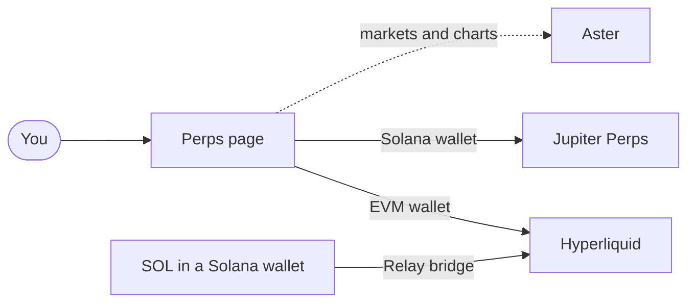

# Just Stealth It Perps

Perps is the trading section of [Just Stealth It](https://juststealthit.xyz) ($STEALTH) for perpetuals and spot. It shows markets from three venues side by side. You trade on the venue itself, from your own wallet.

| Venue | Chain | Markets | Trading here |
| --- | --- | --- | --- |
| **Hyperliquid** | HyperCore | Every listed perp, and spot pairs | **On**, from an EVM wallet |
| **Jupiter Perps** | Solana | SOL, ETH and BTC perps | **On**, from a Solana wallet |
| **Aster** | BNB Chain | USDT perps, including some stocks and commodities | Markets and charts now, trading coming soon |

- Site: [juststealthit.xyz/perps](https://juststealthit.xyz/perps)
- X: [x.com/juststealthit](https://x.com/juststealthit)
- Telegram: [t.me/juststealthit](https://t.me/juststealthit)
- Support: the form on [juststealthit.xyz/status](https://juststealthit.xyz/status)

Your positions are held by the venue, not by Just Stealth It. Orders are signed by your wallet, or by a trading key your wallet approved in your own browser. See [Safety and risk](docs/safety-and-risk.md).

## Start here

| Page | What it covers |
| --- | --- |
| [Getting started](docs/getting-started.md) | Your first trade, for each kind of wallet |
| [Venues](docs/venues.md) | Hyperliquid, Jupiter and Aster compared, and where their fees are listed |
| [Wallets and approvals](docs/wallets.md) | Which wallet trades which venue, the one-time approvals, Solana users on Hyperliquid |

## Using Perps

| Page | What it covers |
| --- | --- |
| [Markets](docs/markets.md) | The market list, venues per coin, spot pairs, stocks and commodities, prices and logos |
| [Charts](docs/charts.md) | The Live chart, the TradingView chart and the switch between them |
| [The order ticket](docs/order-ticket.md) | Long and short, market and limit, amount, leverage, size, liquidation price, how an order is routed |
| [Positions and orders](docs/positions.md) | Open positions, resting orders, history, closing and cancelling |
| [Deposits and withdrawals](docs/deposits-and-withdrawals.md) | Funding a Hyperliquid account through Relay, and getting money out |
| [Portfolio](docs/portfolio.md) | The Perps card in Portfolio |
| [Phones](docs/mobile.md) | The layout on a phone |

## Trust

| Page | What it covers |
| --- | --- |
| [Safety and risk](docs/safety-and-risk.md) | Who holds what, what the site can and can't do, the risks of leverage |
| [FAQ](docs/faq.md) | Short answers |
| [Glossary](docs/glossary.md) | Funding, mark price, liquidation, leverage, margin, cross and isolated |

## How it fits together

## What's on right now

| Feature | State |
| --- | --- |
| Market list across all three venues | On |
| Live chart and TradingView chart | On |
| Hyperliquid perps and spot trading, from an EVM wallet | On |
| Jupiter Perps trading, from a Solana wallet | On |
| Deposits into Hyperliquid through Relay, from SOL or an EVM wallet's coin | On |
| Positions, open orders and history | On |
| Perps card in Portfolio | On |
| Aster trading | Coming soon. Markets and charts are live |
| Perps accounts for Solana wallets, to trade Hyperliquid without an EVM wallet | Coming soon |
| Withdrawals from the Perps page | Coming soon. A Hyperliquid account is yours, so you can withdraw on Hyperliquid's own app today |
| Take profit and stop loss | Coming soon |

## Fine print

Perpetuals use leverage and can lose more than you expect. A position can be liquidated and the margin in it lost. Perps are not available in every country. Nothing here is financial advice or a promise of any return.

Just Stealth It is not affiliated with Hyperliquid, Jupiter, Aster, Relay, TradingView or Solana Foundation.

## License

[MIT](LICENSE)
