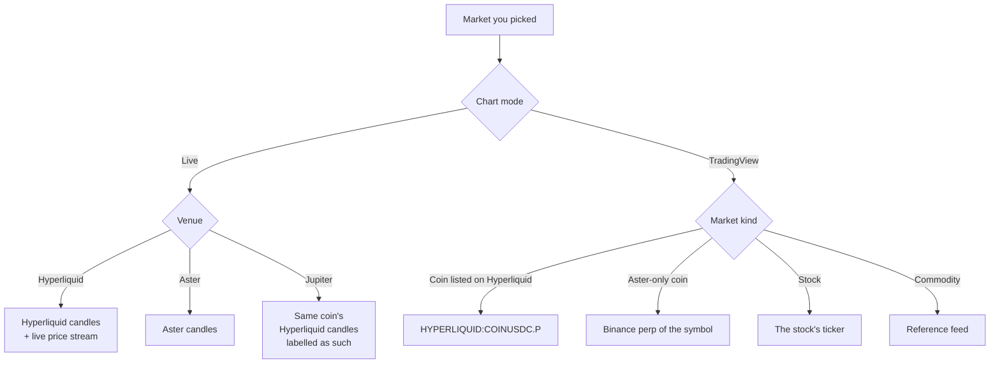

# Charts

The chart has two modes and one switch, **Live | TradingView**, at the top right of the chart. Your choice is remembered in this browser.

Both share the interval strip at the top left: **1m, 5m, 15m, 1h, 4h, 1d, 1w**. The chart opens on 15m.

## Live

The Live chart draws the venue's own candles, with volume bars under them.

| Venue | Candles from | Last candle |
| --- | --- | --- |
| Hyperliquid | Hyperliquid | Moves with every live price tick |
| Aster | Aster | Moves with each price refresh |
| Jupiter | The same coin's Hyperliquid market | Updated with each candle refresh |

Jupiter has no candles of its own. Its Live chart is the Hyperliquid chart of the same coin, and the chart says **Chart: Hyperliquid SOL** (or ETH, BTC). Jupiter's own price can differ a little from Hyperliquid's.

About a thousand candles load for the interval you pick. They refresh about every 30 seconds.

Use Live when you want the venue's own numbers.

## TradingView

The TradingView chart is TradingView's own embedded chart. It has long history, indicators and drawing tools. It's dark to match the site and uses the site's language.

TradingView doesn't carry every venue, so the chart shows the same instrument from the best source TradingView has:

| Market | TradingView symbol |
| --- | --- |
| A Hyperliquid perp | Hyperliquid's own perp, such as `HYPERLIQUID:BTCUSDC.P` |
| A Jupiter or Aster perp of a coin Hyperliquid also lists | The Hyperliquid perp of that coin |
| A Hyperliquid spot pair | The coin's Hyperliquid perp if it has one, otherwise a broad crypto index |
| An Aster perp Hyperliquid doesn't list | Binance's perp of the same symbol |
| A stock | The stock's own ticker |
| A commodity | A common reference feed, such as `OANDA:XAUUSD` for gold |
| Anything else | A broad crypto index for the coin |

So the TradingView chart can differ from the venue's own price, especially for Aster-only coins, stocks and commodities. Check the price in the header and the ticket before you trade.

The TradingView chart reloads when you change market or interval, so drawings and indicators you added can reset.

## Where each chart comes from

Next: [The order ticket](order-ticket.md)
