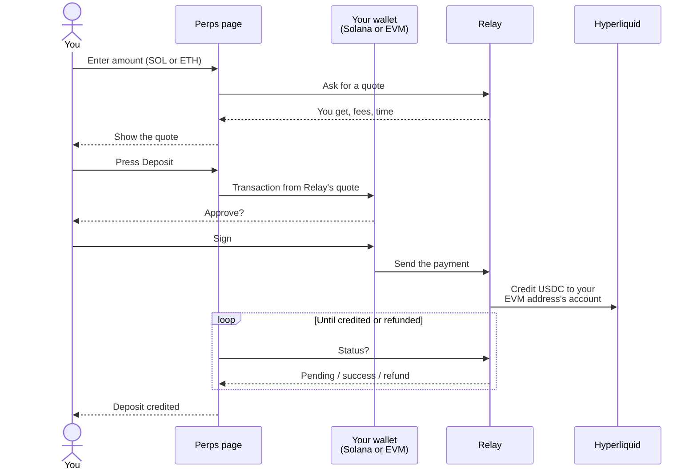

# Deposits and withdrawals

## Which venues need a deposit

| Venue | Deposit |
| --- | --- |
| Hyperliquid | Yes. Orders use the USDC in your Hyperliquid account |
| Jupiter | No. Each trade is paid in SOL from your wallet |
| Aster | Comes with Aster trading, coming soon |

## Depositing into Hyperliquid

Press **Deposit** next to your perps balance, or on the ticket when it asks. The **Deposit to Hyperliquid** sheet opens.

Deposits are bridged by [Relay](https://relay.link), a cross-chain bridge. The USDC lands in the Hyperliquid account of your connected EVM wallet.

| You pay from | In |
| --- | --- |
| **Solana wallet (SOL)** | SOL |
| Your EVM wallet | The native coin of the network it's on, such as ETH |

If both wallets are connected, a **From** switch picks between them.

### The steps

1. Enter what you pay under **You pay**.
2. A live quote appears:

   | Line | What it means |
   | --- | --- |
   | You get | The USDC credited to your Hyperliquid account |
   | Fees | The cost of the bridge and swap: what you pay minus what you get |
   | Arrives in about | Relay's time estimate |

3. Press **Deposit** and sign in the wallet you're paying from. Nothing is signed before the quote shows.
4. The sheet follows Relay until the USDC is credited. It then says **Deposit credited** and your perps balance updates.

If Relay can't complete it, the sheet says **Deposit failed** or **Deposit refunded**. A refund goes back to the wallet that paid.

### Before you deposit

- Hyperliquid accepts no orders from an account that has never deposited, so deposit before **Enable trading**.
- Keep a little SOL, or your EVM network's coin, for network fees.
- The deposit goes to the EVM address you have connected. Check it's the wallet you mean to trade from.
- With only a Solana wallet connected, the sheet says perps accounts for Solana wallets open soon. Connect an EVM wallet to deposit today. See [Solana users on Hyperliquid](wallets.md#solana-users-on-hyperliquid).

### Your balance

| Shown | Meaning |
| --- | --- |
| Perps balance | Your Hyperliquid account value, including open PnL |
| Available | What isn't used as margin |

## Withdrawals

Withdrawing from the Perps page is **coming soon**.

Your Hyperliquid account is yours, at your own EVM address. You can withdraw it at any time on [Hyperliquid's own app](https://app.hyperliquid.xyz) with the same wallet. The trading key this site uses can't withdraw.

On Jupiter there's nothing to withdraw. Closing a position pays back in SOL to your wallet.

Next: [Portfolio](portfolio.md)
