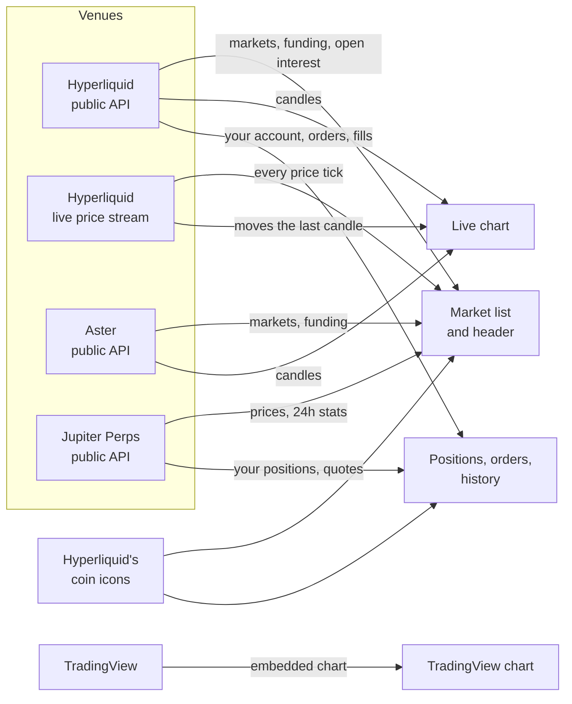

# Markets

## The market list

Press the market name at the top left to open the list. It has a search box and a **Perps | Spot** switch.

| Column | What it shows |
| --- | --- |
| Market | The coin's logo and name, such as BTC-PERP or PURR/USDC |
| Venues | The logo of every venue that lists it |
| Max leverage | The highest leverage any of those venues allows (perps only) |
| Price | The first venue's price |
| 24h change | The first venue's change over 24 hours |
| 24h volume | Volume across every venue that lists it |

On a phone the list keeps the market and the price. Change and volume show on wider screens.

The list is sorted by 24h volume, highest first, and shows the top 80. Search by coin or pair name to find the rest.

## One row per coin

A perp listed on more than one venue gets one row. BTC on Hyperliquid, Aster and Jupiter is one BTC-PERP row with three venue logos.

Picking a row opens the first venue in this order: Hyperliquid, Aster, Jupiter. A **venue switch** then shows at the top of the page. Press another venue to see its price, funding and chart and to trade there.

Aster lists some coins by the thousand, such as 1000PEPE. They show under the coin's own name, PEPE, next to the other venues.

## Spot

Spot markets are Hyperliquid's spot pairs that traded in the last 24 hours. Each pair is its own row, so HYPE/USDC and HYPE/USDT are two rows.

Spot has no leverage, funding or liquidation. The ticket says **Buy** and **Sell** instead of Long and Short.

## Stocks and commodities

Aster lists some stocks, ETFs and commodities as perps. They show in the Perps list by their ticker, next to the crypto markets. Their TradingView chart uses the stock's own ticker or a reference feed for the commodity. Trading them here comes with Aster trading, coming soon.

## The market header

| Item | What it shows |
| --- | --- |
| Price | The current price. Live on Hyperliquid, refreshed about every 20 seconds on Aster and Jupiter |
| 24h change | Percent change over 24 hours |
| 24h volume | Trading volume on this venue over 24 hours |
| Open interest | The value of all open positions. Hyperliquid only; a dash elsewhere |
| Funding | The current rate and its interval, such as 0.0013% / 1h. Positive, in green, means longs pay shorts. Negative, in red, means shorts pay longs. A dash on Jupiter, which has borrow fees instead |
| Venue switch | Shown when more than one venue lists the coin |

Under the header sits your balance: **Perps balance** with what's **Available** on Hyperliquid, and **Deposit**. On Jupiter it says you pay from your Solana wallet.

## Where the data comes from

Everything on this page is read from the venues' own public data. A venue that doesn't answer is left out, and the others still load.

## Logos

- **Venue logos** are each venue's own mark. If one doesn't load, its initials show instead.
- **Coin logos** come from Hyperliquid's public icon set. The site also tries the coin's usual name for wrapped or bridged tokens, so a token like UBTC shows the BTC logo. A coin with no icon anywhere shows its first letters on a colour.

Next: [Charts](charts.md)
