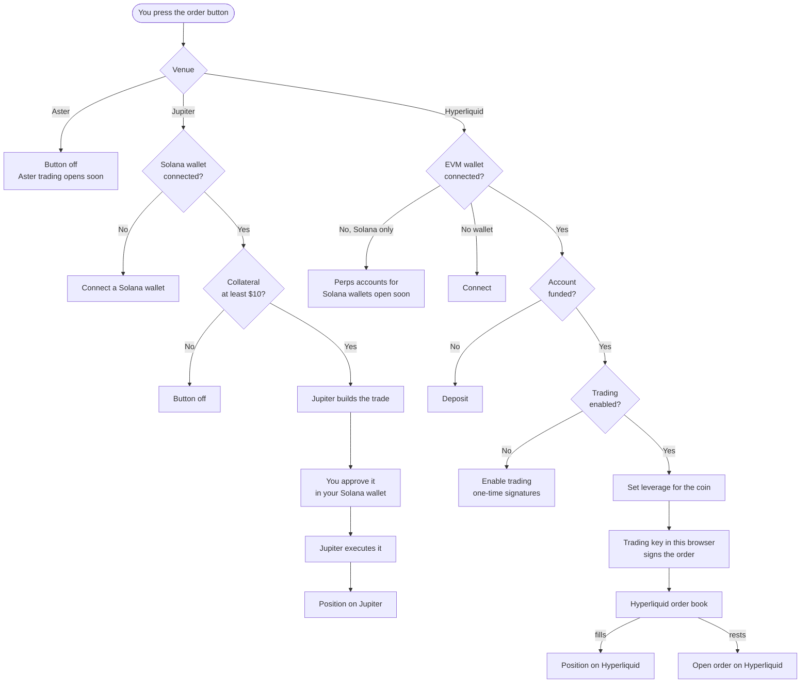

# The order ticket

On a computer the ticket sits right of the chart. On a phone, **Long** and **Short** at the bottom of the screen open it as a sheet. See [Phones](mobile.md).

## The fields

| Field | Hyperliquid perps | Hyperliquid spot | Jupiter |
| --- | --- | --- | --- |
| Side | **Long** or **Short** | **Buy** or **Sell** | **Long** or **Short** |
| Order type | **Market** or **Limit** | **Market** or **Limit** | Market only |
| Amount | **Amount (USD)**, the margin from your perps balance | **Amount (USD)** | **Pay (SOL)**, from your wallet |
| Limit price | For limit orders | For limit orders | — |
| Leverage | Slider from 1x to the market's max | None | Slider from 1x to 100x |
| Size | Coin amount and USD value | Coin amount and USD value | Coin amount and USD value |
| Liq. price | **Liq. price (est.)**, an estimate | — | **Liq. price**, Jupiter's own quote |
| Fees | Estimate | Estimate | Estimate |

Aster markets show the same fields as Hyperliquid perps, with the button off and the note "Aster trading opens soon. Its markets and prices are live."

### Amount and size

The amount is your margin. The size is what you control:

> Size in USD = amount × leverage. Size in coins = size in USD ÷ price.

$100 at 10x is a $1,000 position. On Jupiter the SOL you pay is turned into dollars at the current SOL price.

Hyperliquid rounds the size down to the market's smallest step. An order too small for that step is refused.

### Leverage

The slider runs from 1x to the market's maximum. Quick buttons sit under it: 1x, 2x, 5x, 10x, 20x, 50x, 100x, up to what the market allows. The ticket opens at 5x, or lower if the market's max is lower.

On Hyperliquid, leverage is set for the coin before your order goes in. It applies to your whole position in that coin, in cross margin. See [Glossary](glossary.md#cross-and-isolated).

### Market and limit

| Type | Hyperliquid | Jupiter |
| --- | --- | --- |
| Market | Fills now against the book, up to 5% away from the current price. Any part that can't fill there is cancelled | Fills now, with up to 2% slippage. If the price moves further, the trade is refused |
| Limit | Rests on the book at your price until it fills or you cancel it. Your price is rounded to Hyperliquid's price steps | — |

Open limit orders show under **Orders**. See [Positions and orders](positions.md).

### Liquidation price

- **Hyperliquid: Liq. price (est.)**. A rough figure from the entry price, your leverage and the market's max leverage, as if the position stood alone. Your real liquidation price depends on your whole account, since positions here use cross margin. Once the position is open, **Positions** shows Hyperliquid's own figure.
- **Jupiter: Liq. price**. Jupiter's own quote. It shows once the amount is at least $10.

Treat any liquidation price as a guide. Funding, fees and price moves in other positions can bring it closer.

### Fees

The **Fees** line is an estimate for this order. Each venue charges its own trading fees, and funding or borrow fees while a position is open. See [Venues](venues.md#fees).

### Reduce-only, take profit and stop loss

- **Close** on a Hyperliquid position sends a reduce-only market order. It can only shrink the position, never flip it. A reduce-only switch on the ticket isn't there yet.
- **Take profit and stop loss** are coming soon.

## The button

The button shows the next step that's missing.

| Button | Why |
| --- | --- |
| **Connect** | No wallet for this venue yet |
| **Deposit** | "Deposit to start trading on Hyperliquid". The account has no money yet |
| **Enable trading** | The one-time approvals. See [Wallets](wallets.md#one-time-approvals-on-hyperliquid) |
| **Long BTC 5x**, **Short ETH 10x**, **Buy HYPE** | Ready. Press it to send the order |
| Off | Aster, an amount under Jupiter's $10 minimum, or no amount yet |

After you press it you'll see **Filled at** a price, **Order placed** for a resting limit order, or **Order refused** with the venue's own reason.

## How an order is routed

Orders go from your browser straight to the venue. The site doesn't hold them or fill them.

The ticket's last line is a reminder: "Perpetuals use leverage and can lose more than you expect. Not available in every country."

Next: [Positions and orders](positions.md)
