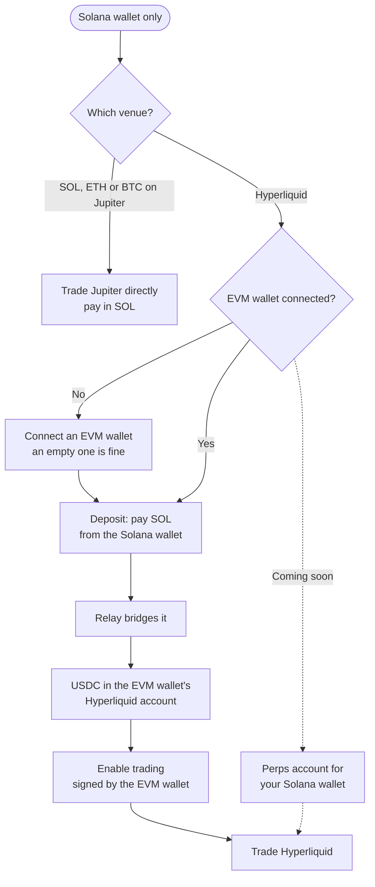

# Wallets and approvals

A wallet you connect stays yours. Just Stealth It never holds its keys, and never holds the money in your perps accounts.

## Which wallet trades which venue

| Venue | Wallet | Whose account |
| --- | --- | --- |
| Hyperliquid | An EVM wallet you connect | Your own Hyperliquid account, at your EVM address |
| Jupiter Perps | A Solana wallet you connect | Positions owned by your Solana address |
| Aster | — | Trading coming soon |

You can connect both kinds at once. Then the EVM wallet trades Hyperliquid and the Solana wallet trades Jupiter. The Solana wallet can also pay for Hyperliquid deposits.

To close a position you need the same wallet connected: the EVM wallet for Hyperliquid, the Solana wallet for Jupiter.

## One-time approvals on Hyperliquid

Hyperliquid accepts actions only from an account that has deposited, so deposit first. Then the ticket shows **Enable trading**.

Pressing it asks your EVM wallet to sign once or twice:

| Signature | What it does |
| --- | --- |
| A trading key | Approves a key kept in this browser to place and cancel orders and set leverage for your account. It can't withdraw or move funds |
| An approval for this site | A one-time approval so orders can be placed from this site. Your wallet shows Hyperliquid's own wording for it |

Both are signed messages, not transactions. They move no funds and cost no gas. Your wallet doesn't need to switch network.

After that, orders, cancels and closes are signed by the trading key. No wallet prompt opens for each order.

The trading key lives in this browser only. If you clear the site's data, use another browser or another device, the ticket asks you to **Enable trading** again. That approves a new key. Hyperliquid's own app lists the keys your account has approved.

## Jupiter approvals

There's no setup on Jupiter. Jupiter builds each trade, and your Solana wallet asks you to approve it. Opening and closing each need your approval.

## Solana users on Hyperliquid

Hyperliquid accounts belong to EVM addresses. A Solana wallet on its own can't hold one yet.

Today:

1. Connect your Solana wallet, as usual.
2. Connect an EVM wallet too. It can be a new, empty one.
3. On a Hyperliquid market, press **Deposit** and choose **Solana wallet (SOL)**.
4. Sign in your Solana wallet. Relay bridges the SOL and credits USDC to the EVM wallet's Hyperliquid account.
5. Press **Enable trading** and sign with the EVM wallet.
6. Trade.

With only a Solana wallet connected, a Hyperliquid or Aster ticket says: "Perps accounts for Solana wallets open soon. Until then, trade Jupiter from your Solana wallet, or connect an EVM wallet for Hyperliquid."

**Coming soon:** a perps account for each Solana wallet, so Solana users can trade Hyperliquid, and later Aster, without connecting an EVM wallet.

## Safety

- Nobody from Just Stealth It will ever ask for your recovery phrase.
- Read every wallet prompt before you sign. The site never asks your wallet to send funds anywhere for setup.
- The trading key can't withdraw. Only your wallet can.

Next: [Markets](markets.md)
